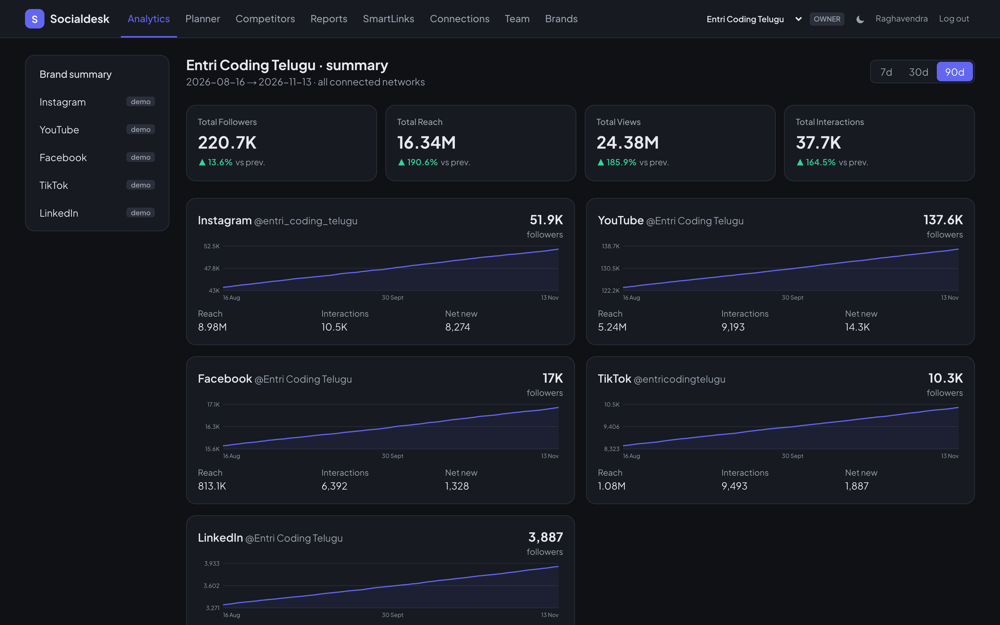
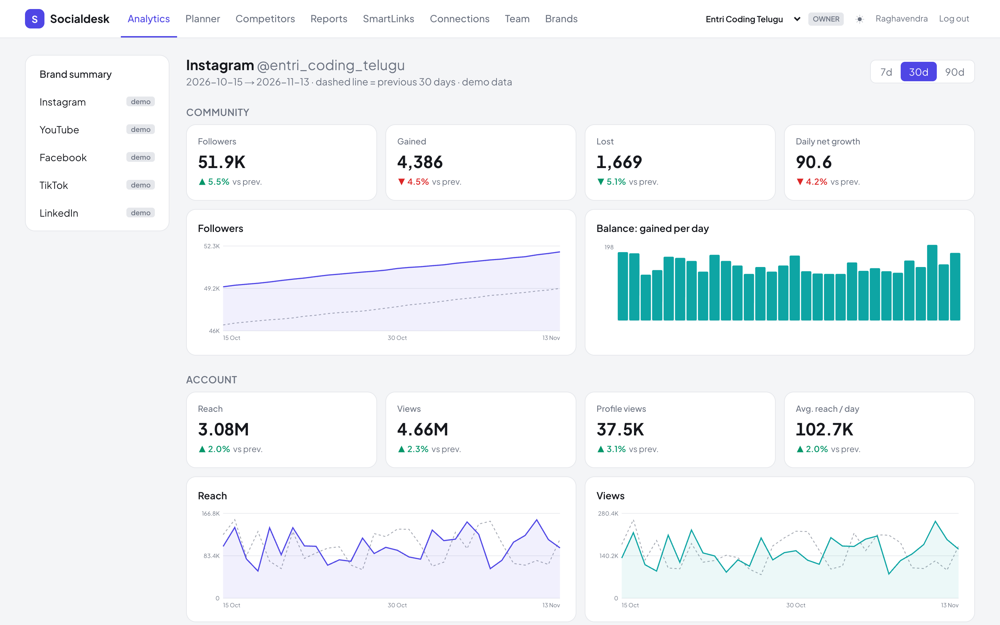
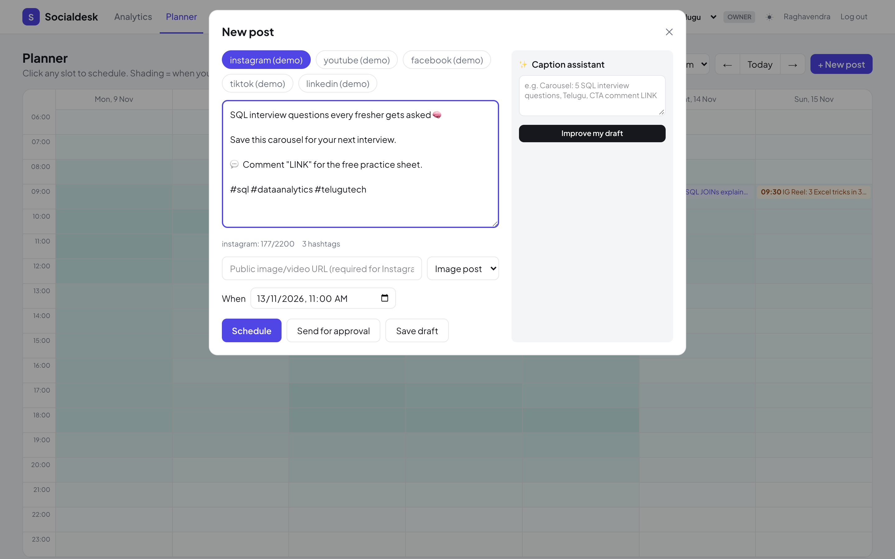
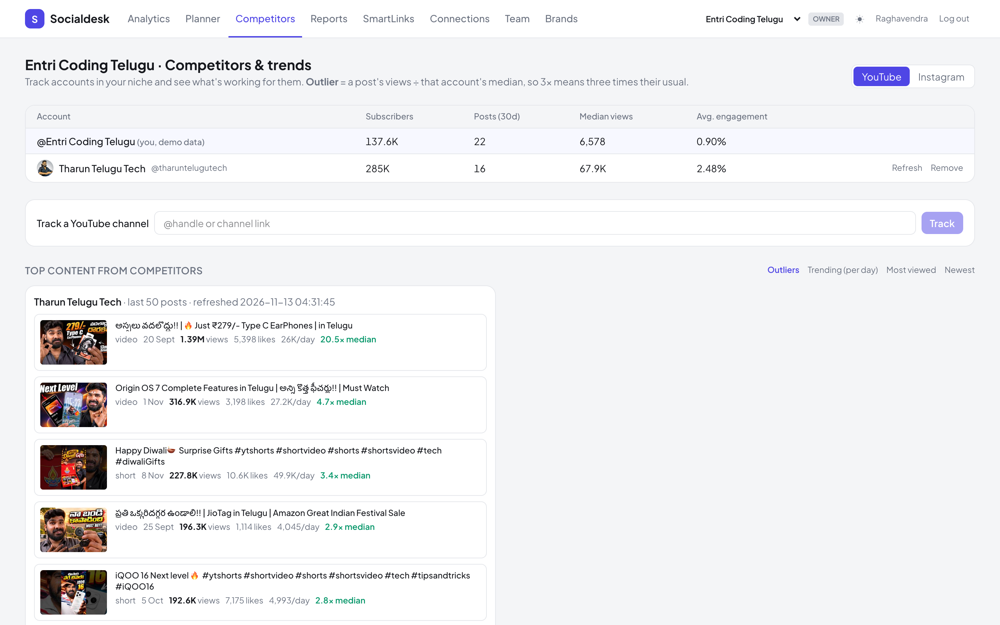
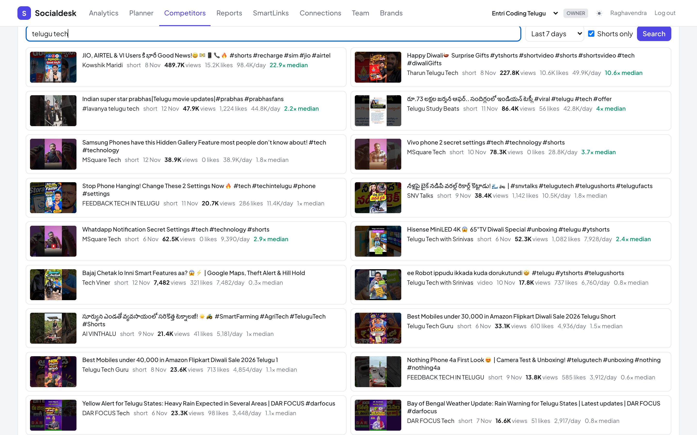
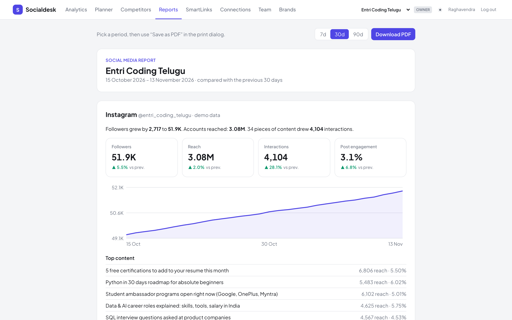
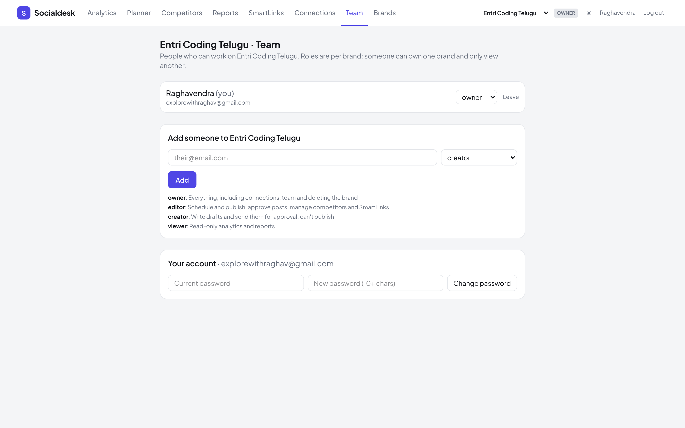

<p align="center"></p>

<p align="center">
  
  
  
</p>

<p align="center"><b>Plan, publish and analyze social media for every brand you run, from one self-hosted dashboard.</b><br>
Multi-brand, multi-user, with competitor outliers and niche trends. Built by Raghav.</p>

## ✨ Features

<table>
<tr><td width="50%" valign="top"><h3>📊 Analytics</h3>Followers, reach, views, engagement and audience for every network, compared with the previous period. CSV export.</td>
<td width="50%" valign="top"><h3>🗓 Planner</h3>Week calendar shaded by your best posting times, approval flow, auto-publishing and an AI caption assistant.</td></tr>
<tr><td></td><td></td></tr>
<tr><td valign="top"><h3>🔍 Competitors & trends</h3>Track channels in your niche, spot their outlier videos (views ÷ their median) and search what's trending.</td>
<td valign="top"><h3>🔥 Trending in your niche</h3>Most-viewed YouTube Shorts for a keyword, ranked by views per day; Instagram hashtag top posts.</td></tr>
<tr><td></td><td></td></tr>
<tr><td valign="top"><h3>📄 Reports</h3>One-click PDF report per brand.</td><td valign="top"><h3>🔗 SmartLinks & 👥 Team</h3>Link-in-bio pages with click tracking; owner / editor / creator / viewer roles per brand.</td></tr>
<tr><td></td><td></td></tr>
</table>

<p align="center"><sub>Light and dark themes · screenshots use demo data</sub></p>

---

# Socialdesk

Our own Metricool-style social media tool for the Entri Coding Telugu brand: plan and auto-publish posts, analyze every network, benchmark competitors, export reports, and run a link-in-bio page.

How Metricool itself works, and why this app is shaped the way it is, is in [`docs/metricool-recon.md`](docs/metricool-recon.md).

## Run it

```bash
cd web
cp .env.local.example .env.local   # add ANTHROPIC_API_KEY for the caption assistant
npm install
npm run dev                        # http://localhost:3000
```

On first start the app creates `data/app.db` (SQLite, built into Node 24+) with two brands:
- **Entri Coding Telugu**, filled with 120 days of demo data;
- **raghavTalkz**, empty.

To start over, stop the server and delete `data/app.db*`.

## Brands

Like Metricool, everything belongs to a **brand**. Each brand has its own connected accounts (one per network), analytics history, planner, approval queue, competitors, reports and link-in-bio page.
- **Switching:** use the selector in the top bar, which is remembered in a cookie. API calls can also pass `?blogId=<brand id>`.
- **Brands page** (`/brands`): create a brand for each new channel, fill a brand's unconnected networks with demo data, or delete a brand and all its data.
- **One brand per account:** an Instagram account can only be live-connected to one brand at a time.

## Logins and roles

- **First run:** opening the app shows **/setup**. The account you create there becomes owner of every brand that already exists. After that, /setup is closed.
- **Adding people:** an owner adds someone on the **Team** page. If they have no account yet, the owner gives a name and a temporary password and shares it privately. They can change it on the Team page, which also signs out their other devices.
- **Roles are per brand:** the same person can own raghavTalkz and only view Entri.

| Role | Can do |
|---|---|
| owner | Everything: connections, team, deleting the brand |
| editor | Schedule and publish, approve posts, competitors, SmartLinks, sync |
| creator | Write drafts and send them for approval (no publishing), caption assistant |
| viewer | Read-only analytics, planner and reports |

**How it's enforced:**
- **Passwords** are hashed with scrypt.
- **Sessions** are random 32-byte tokens in an httpOnly cookie, and only their SHA-256 is stored. They last 30 days.
- **Login limit:** 5 failed logins per email and IP locks that combination for 15 minutes.
- **Cross-site protection:** requests that change data are rejected unless they come from the app's own origin.
- **Server-side checks:** every API route checks your membership and role on the brand.
- **Public pages:** the link-in-bio pages under `/l/` stay public.

**Locked out?** Stop the server and run:

```bash
node -e 'const {DatabaseSync}=require("node:sqlite");const d=new DatabaseSync("data/app.db");d.exec("DELETE FROM sessions; DELETE FROM brand_members; DELETE FROM users;")'
```

This removes all accounts but keeps every brand and its data. The next visit shows /setup again.

## What's in it

| Area | Path | Notes |
|---|---|---|
| Brand summary | `/analytics` | Every network side by side, with 7/30/90-day periods and comparison to the previous period |
| Network analytics | `/analytics/[network]` | Community, account, content KPIs, charts, sortable posts table, CSV export, hashtags, demographics |
| Planner | `/planner` | Week calendar shaded by best posting times. Post editor with per-network character limits, approval flow (draft → pending approval → scheduled → published) and an AI caption assistant |
| Scheduler | `src/lib/scheduler.ts` | Runs inside the server every 30 s and publishes due posts. Demo networks are marked "simulated" |
| Competitors | `/competitors` | Instagram benchmark table. Real numbers come from the Business Discovery API |
| Reports | `/reports` | Printable per-network report → "Download PDF" |
| SmartLinks | `/smartlinks`, public `/l/[slug]` | Link-in-bio editor with click tracking |
| Settings | `/settings` | Switch a network from demo to live |

The API copies Metricool's generic analytics shape, so one chart component works for every network:

- `GET /api/v2/analytics/timelines?network=&subject=account|posts|reels&metric=&from=&to=`
- `GET /api/v2/analytics/aggregation` · `/distribution` · `/posts/{network}[?format=csv]`
- `GET|POST /api/v2/scheduler/posts` · `PATCH|DELETE /api/v2/scheduler/posts/{id}` · `GET /api/v2/scheduler/besttimes/{network}`

## Connecting Instagram for real

Go to Settings → Instagram and enter:
- the Instagram Business account's user id;
- a long-lived token with `instagram_basic`, `instagram_manage_insights`, `instagram_content_publish`, `pages_show_list`, `pages_read_engagement` and `business_management`.

The settings page has step-by-step instructions. For our own accounts, the Meta app can stay in development mode, so there's no app review. Connecting deletes Instagram's demo data and runs a first sync. After that, use "Sync now" on the analytics page.

Instagram only publishes media from a public URL. Images and Reels are supported; carousels and stories aren't yet.

## Connecting networks (Connections page)

| Network | How | Analytics | Publishing | One-time setup |
|---|---|---|---|---|
| Facebook Page + Instagram | **Continue with Facebook**, then pick the Page. Pasting a Graph API Explorer token is still available under "Advanced". | Yes | Facebook: photo/text. Instagram: image/Reel | Meta app with Facebook Login: `META_APP_ID`/`META_APP_SECRET`. Redirect URI `…/api/oauth/meta/callback` |
| YouTube | **Connect with Google** | Subscribers, views, watch time, gained/lost, videos, audience | Video upload from a URL | Google Cloud OAuth client: `GOOGLE_CLIENT_ID`/`GOOGLE_CLIENT_SECRET` |
| LinkedIn | **Import LinkedIn export** for analytics; **Connect with LinkedIn** for posting | From LinkedIn's own export (.xlsx): daily impressions and engagements, followers, top posts, audience by location, job title, industry, seniority and company size | Text posts to your profile | Analytics: none. Posting: LinkedIn app with `LINKEDIN_CLIENT_ID`/`LINKEDIN_CLIENT_SECRET` |
| X (Twitter) | **Connect with X** | Followers and post metrics (heavily limited on the Free tier) | Text posts | X app with OAuth 2.0: `X_CLIENT_ID`/`X_CLIENT_SECRET` |

Each provider's redirect URI is `http://localhost:3210/api/oauth/<google|linkedin|x>/callback`. Set `APP_URL` if the app runs on another address. The Connections page shows the exact URI and step-by-step instructions for each network.

**Tokens and syncing:**
- **Automatic refresh:** Google and X tokens refresh on their own.
- **LinkedIn** tokens last 60 days, then need a reconnect.
- **Google in Testing mode:** while your Google consent screen is in Testing, the connection expires after 7 days.
- **Auto-sync:** every live account re-syncs every 6 hours.

**LinkedIn import:** LinkedIn's API doesn't share personal-profile analytics with self-made apps, so Socialdesk reads the file LinkedIn lets you export (profile → Analytics → Post impressions → Export).
- **What maps where:** daily impressions become views and reach; "new followers" become gained; the follower history is rebuilt backwards from the export's total.
- **Top posts:** a post's engagements are stored in the Likes column.
- **Re-importing** updates existing days instead of duplicating them.
- **Connecting LinkedIn for posting later** keeps the imported history.

**Known limits:**
- **YouTube:** the API exposes no "reach", so YouTube uses views as reach. Videos uploaded through an unverified Google project are set to Private until Google audits it.
- **Images:** not attached yet on X and LinkedIn. On LinkedIn the image link is appended to the post instead.

## Competitors & trends

- **Track accounts:** add a YouTube channel (@handle or link) or an Instagram Business/Creator account. Socialdesk fetches their profile and last 50 posts, and refreshes them every 12 hours or with **Refresh**.
- **Top content:** sort by **Outlier** (views ÷ that account's median), **Trending** (views per day since posting), most viewed, or newest.
- **Trending in your niche:** a YouTube keyword search (region India, last 1/7/30/90 days, Shorts only if you want) or an Instagram hashtag's top posts.
- **YouTube data source:** uses your connected YouTube account, or `YOUTUBE_API_KEY` if set. The free quota is 10,000 units a day; a search costs 100 and a channel refresh about 3.
- **Instagram data source:** needs the brand's Instagram connected through Facebook. Meta doesn't share other accounts' views, so Instagram is ranked by likes + comments. Hashtag search allows 30 hashtags per 7 days.

## Dark mode

The ◐ / ☾ / ☀ button in the top bar switches between following the system, dark, and light. The choice is remembered in the browser.

## Not built yet

- Live connectors for YouTube, Facebook, LinkedIn and TikTok. They still show demo data.
- Unified inbox (comments/DMs).
- Ads analytics.
- Email invites and "forgot password". The owner shares temporary passwords by hand.
- HTTPS. Before putting this on the internet, run it behind HTTPS with `NODE_ENV=production` so the session cookie is marked Secure.
- Daily automatic sync. Today, sync runs on demand ("Sync now").
- Token encryption. Tokens are stored in plain text in SQLite.
