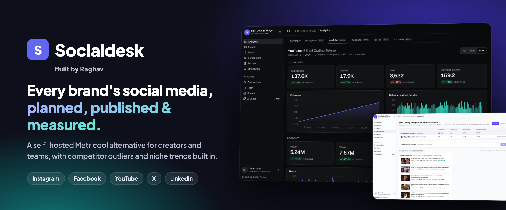
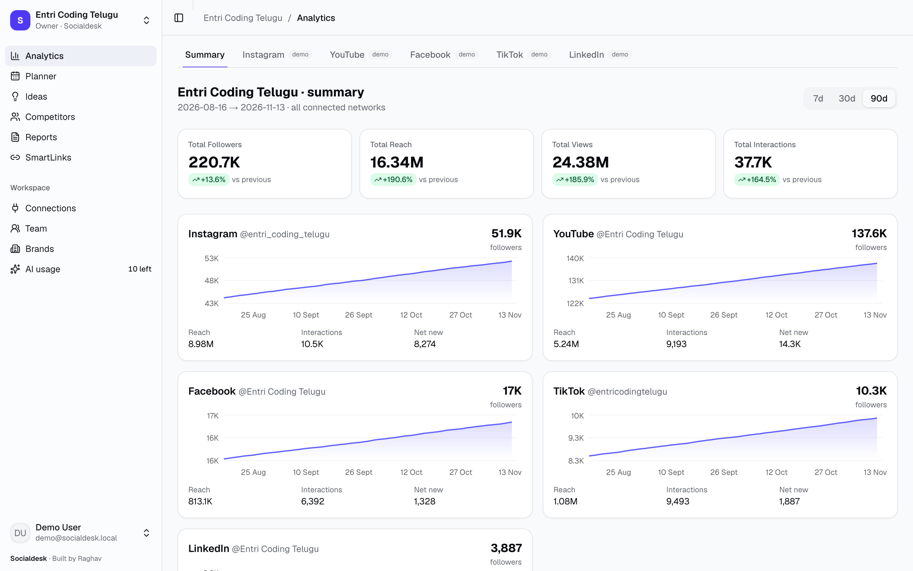
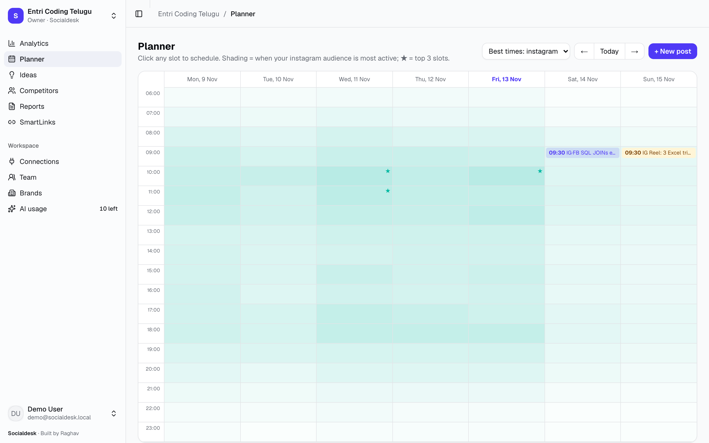
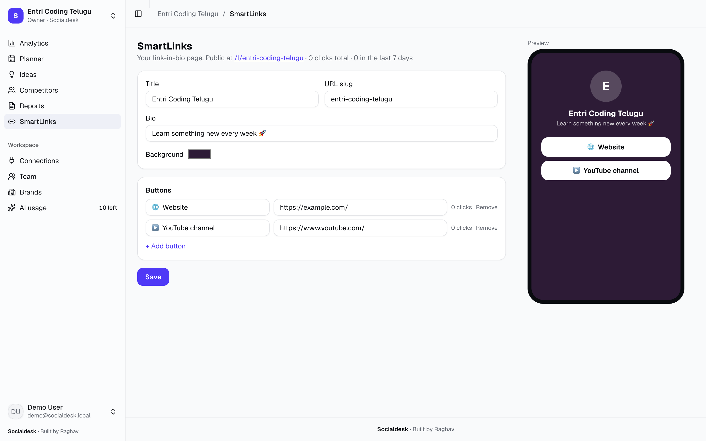
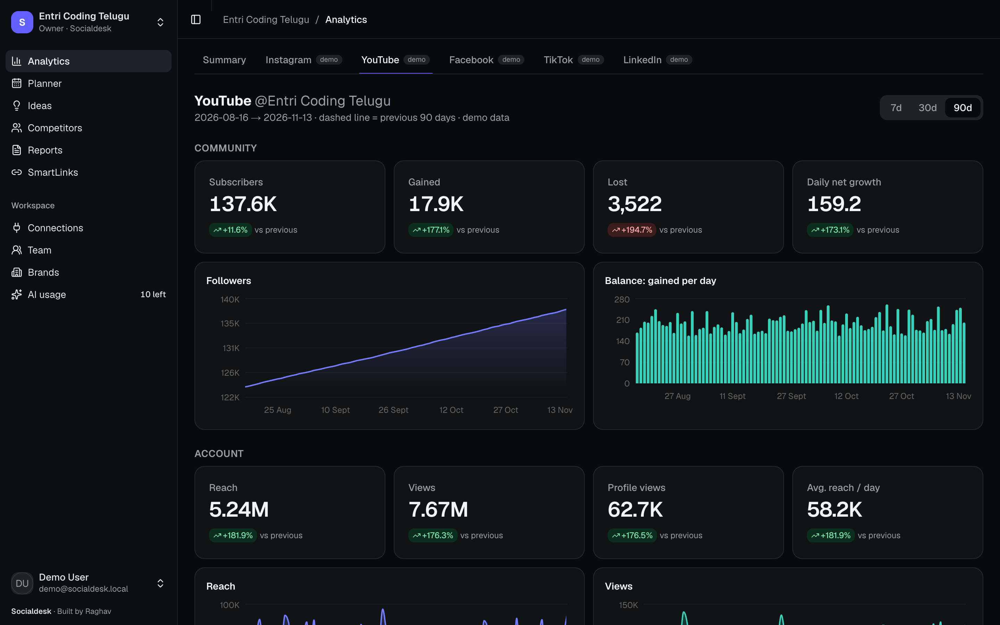
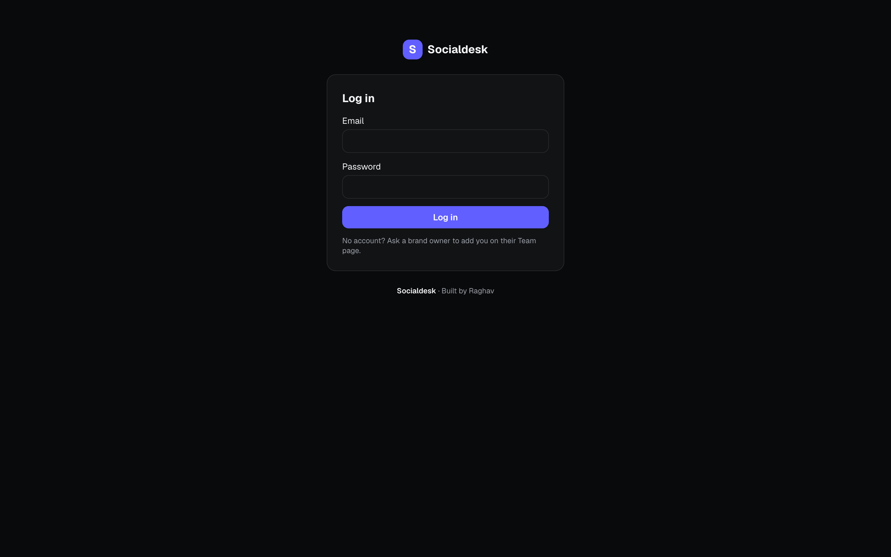

<p align="center">
  
</p>

<p align="center">
  
  
  
  
</p>

<p align="center">
  <b>Plan, publish and analyze social media for every brand you run, from one self-hosted dashboard.</b><br>
  Instagram, Facebook, YouTube, X and LinkedIn, with a team, approvals, competitor outliers and niche trends built in.
</p>

<p align="center">
  <a href="#-features">Features</a> ·
  <a href="#-quick-start">Quick start</a> ·
  <a href="#-connect-your-networks">Connect networks</a> ·
  <a href="#-team--roles">Team & roles</a> ·
  <a href="#-how-it-works">How it works</a> ·
  <a href="#-roadmap">Roadmap</a>
</p>

<p align="center">
  
</p>

## ✨ Features

<table>
<tr>
<td width="50%" valign="top">

### 📊 Analytics for every network
Followers, reach, views, engagement and audience for each account, with a dashed line for the previous period. A sortable posts table, CSV export, top hashtags and audience breakdowns (city, age, gender, job titles and more).

</td>
<td width="50%" valign="top">

### 🗓 Planner with best times
A week calendar shaded by when your audience is online, with ★ on the three best slots. Write once, pick networks, and the scheduler publishes on time.

</td>
</tr>
<tr>
<td></td>
<td></td>
</tr>
<tr>
<td width="50%" valign="top">

### ✍️ Post editor with approvals
Per-network character limits, drafts, **send for approval → approve & schedule**, and an AI caption assistant (Claude) that writes three options in Telugu-English or English.

</td>
<td width="50%" valign="top">

### 🔍 Competitor outliers
Track any YouTube channel or Instagram professional account. See which of their posts did **N× their usual views**: the ideas worth borrowing.

</td>
</tr>
<tr>
<td></td>
<td></td>
</tr>
<tr>
<td width="50%" valign="top">

### 🔥 Trending in your niche
Search a keyword to get the most-viewed YouTube Shorts and videos from the last day, week or month, ranked by **views per day**. Or search an Instagram hashtag's top posts.

</td>
<td width="50%" valign="top">

### 📄 One-click reports
A clean per-brand report with KPIs, growth charts, top content and best-time heatmaps. Save it as a PDF and send it to a client or your manager.

</td>
</tr>
<tr>
<td></td>
<td></td>
</tr>
<tr>
<td width="50%" valign="top">

### 🔗 SmartLinks (link in bio)
A link-in-bio page for each brand at `/l/your-brand`, with a live phone preview and click counts per button.

</td>
<td width="50%" valign="top">

### 👥 Brands, team & roles
Run any number of brands from one login. Invite people per brand as **owner, editor, creator or viewer**.

</td>
</tr>
<tr>
<td></td>
<td></td>
</tr>
<tr>
<td colspan="2" valign="top">

### 💡 Ideas: what to record next
Save your niche keywords and Socialdesk shows what's **rising in your niche**, what's **proven by competitors** (their outliers) and **your own winners** worth a part 2, plus the words that keep showing up in posts that work. One click saves any idea as a draft in the Planner, and **Write me 8 video ideas** has Claude turn the evidence into titles, hooks and outlines.

</td>
</tr>
<tr>
<td colspan="2"></td>
</tr>
</table>

<p align="center"><sub>Light, dark or follow-the-system theme (◐ in the sidebar). All screenshots use the built-in demo data.</sub></p>

## 🚀 Quick start

You need **Node.js 24 or newer**; the database is Node's built-in SQLite, so there's nothing else to install.

```bash
git clone https://github.com/raghavsunil99/socialdesk.git
cd socialdesk
cp .env.local.example .env.local
npm install
npm run dev -- -p 3210
```

Then:
1. Open **http://localhost:3210**. The first visit shows **Create the owner account**; that account owns every brand.
2. Look around: the **Entri Coding Telugu** brand comes filled with 120 days of demo data. A second brand, **raghavTalkz**, starts empty.
3. Pick a brand in the sidebar, open **Connections**, and connect real accounts (below).

Port 3210 matters because it's part of the sign-in redirect addresses you register with Google, Meta, LinkedIn and X. To use another port or a domain, set `APP_URL` and register that address instead. To start over, stop the server and delete `data/app.db*`.

## 🔌 Connect your networks

Every brand has its own connections. Each network needs a free developer app, created once, and two keys in `.env.local`; the **Connections** page has step-by-step instructions and shows the exact redirect address to register.

| Network | How you connect | Analytics | Publishing | Keys in `.env.local` |
|---|---|---|---|---|
| **Facebook Page + Instagram** | **Continue with Facebook**, then pick the Page | Followers, reach, views, gained/lost, posts and Reels, audience | Facebook photo/text · Instagram image/Reel | `META_APP_ID`, `META_APP_SECRET` |
| **YouTube** | **Connect with Google** | Subscribers, views, watch time, gained/lost, every video, age/gender/country | Video upload from a URL | `GOOGLE_CLIENT_ID`, `GOOGLE_CLIENT_SECRET` |
| **X** | **Connect with X** | Followers and post metrics (very limited on X's free tier) | Text posts | `X_CLIENT_ID`, `X_CLIENT_SECRET` |
| **LinkedIn** | **Import** LinkedIn's analytics export; **Connect with LinkedIn** for posting | Impressions, engagements, followers, top posts, audience by job title, industry and location | Text posts to your profile | `LINKEDIN_CLIENT_ID`, `LINKEDIN_CLIENT_SECRET` (posting only) |

Optional keys:
- `ANTHROPIC_API_KEY`: turns on the caption assistant.
- `YOUTUBE_API_KEY`: a separate quota for competitor and trend lookups.
- `META_CONFIG_ID`: if your Meta app uses Facebook Login for Business configurations.

<details>
<summary><b>Good to know</b></summary>

- **History:** like Metricool, Socialdesk saves a snapshot of each account every 6 hours, so history grows from the day you connect. The first YouTube sync backfills 30 days.
- **Reconnecting** the same account keeps its history. Switching to a different account starts fresh.
- **Tokens:** Google and X renew theirs automatically; LinkedIn's last 60 days. While your Google project is in *Testing*, Google expires the connection after 7 days, so publish the app to stop that.
- **YouTube:** the API has no "reach", so views are used as reach. Videos uploaded through an unverified Google project stay Private until Google verifies it.
- **LinkedIn:** personal-profile analytics aren't available to self-made apps, so Socialdesk imports the file LinkedIn lets you download (profile → Analytics → Post impressions → Export). Re-importing updates days instead of duplicating them.
- **Instagram competitors and hashtags** need the brand's Instagram connected, only work for professional accounts, and are ranked by likes + comments (Meta doesn't share other accounts' views).
- **YouTube quota:** 10,000 units a day; a trend search costs 100, a competitor refresh about 3.

</details>

## 👥 Team & roles



Add people on the **Team** page. Roles are per brand, so someone can own one brand and only view another.

| Role | Can do |
|---|---|
| **Owner** | Everything: connections, team, deleting the brand |
| **Editor** | Schedule and publish, approve posts, competitors, SmartLinks, sync |
| **Creator** | Write drafts and send them for approval, use the caption assistant (can't publish) |
| **Viewer** | Read-only analytics, planner and reports |

**Security:**
- **Passwords** are hashed with scrypt.
- **Sessions** are random tokens in an httpOnly cookie; only their hash is stored.
- **Login limit:** 5 failed logins lock that email for 15 minutes.
- **Cross-site requests** that change data are blocked.
- **Permissions** are checked on the server for every request.
- **Public:** only the link-in-bio pages under `/l/` can be opened without logging in.

<details>
<summary><b>Locked out?</b></summary>

Stop the server and run this in the project folder. It removes all accounts but keeps every brand and its data, and the next visit shows the setup screen again.

```bash
node -e 'const {DatabaseSync}=require("node:sqlite");const d=new DatabaseSync("data/app.db");d.exec("DELETE FROM sessions; DELETE FROM brand_members; DELETE FROM users;")'
```

</details>

## 🧠 How it works

Socialdesk copies the parts of Metricool that matter. The full teardown is in [docs/metricool-recon.md](docs/metricool-recon.md).

- **One generic metric API:** charts ask for a `network + subject + metric` series instead of having one endpoint per chart, the same shape Metricool uses:
  - `GET /api/v2/analytics/timelines?network=instagram&subject=account&metric=followers&from=&to=`
  - `GET /api/v2/analytics/aggregation` · `/distribution` · `/posts/{network}?format=csv`
  - `GET|POST /api/v2/scheduler/posts` · `PATCH|DELETE /api/v2/scheduler/posts/{id}` · `GET /api/v2/scheduler/besttimes/{network}`
- **Daily snapshots** in SQLite (`metric_points`), so history keeps growing after you connect.
- **Connectors** in `src/lib/connectors/` implement `sync` and `publish` for each network. A background job inside the server publishes due posts every 30 seconds and re-syncs accounts every 6 hours.

```
src/
  app/            pages and API routes (Next.js App Router)
  components/     app shell (sidebar), charts, post cards; ui/ = shadcn/ui
  lib/
    db.ts         SQLite schema and migrations
    auth.ts       passwords, sessions, roles
    brand.ts      brand membership and role checks
    metrics.ts    the analytics engine
    oauth.ts      Google / LinkedIn / X / Meta sign-in and token refresh
    connectors/   instagram, facebook, youtube, linkedin, x
    competitors.ts  competitor content, outliers, trending search
    importers/    LinkedIn analytics export
    scheduler.ts  publishing and background sync
```

**Stack:** Next.js 15 (App Router) · React 19 · [shadcn/ui](https://ui.shadcn.com) (Radix + Tailwind CSS 4) · Recharts · Lucide icons · TypeScript · `node:sqlite` · Gemini (`@google/genai`) · ExcelJS.

## 🗺 Roadmap

- TikTok connector
- Unified inbox for comments and DMs
- Ads analytics (Meta, Google)
- Image attachments for X and LinkedIn posts, carousels for Instagram
- Email invites and "forgot password"
- Encrypting stored tokens

**Before putting it on the internet:** run it behind HTTPS with `NODE_ENV=production`, so the session cookie is marked Secure. Tokens are currently stored unencrypted in `data/app.db`; keep that file private.

---

<p align="center"><sub>Built by Raghav · inspired by <a href="https://metricool.com">Metricool</a></sub></p>
